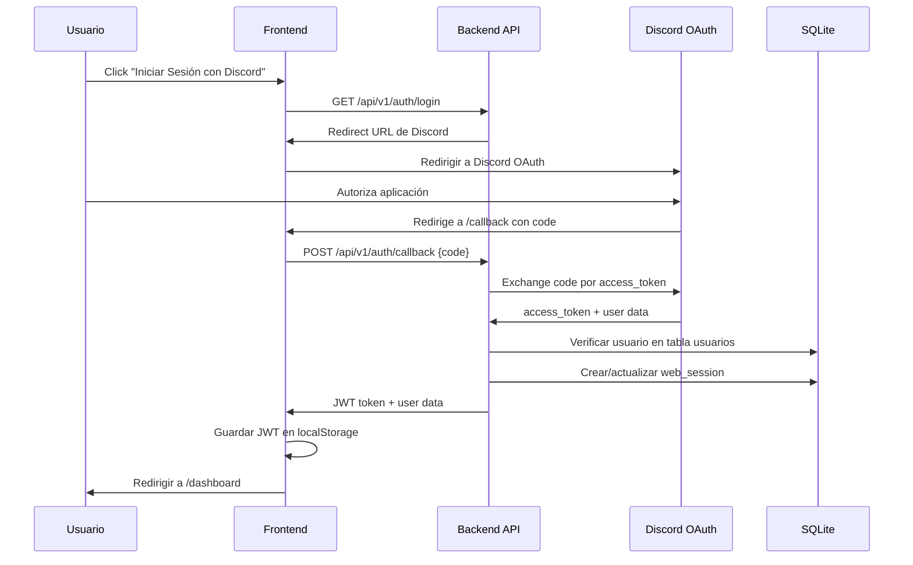

# 🏛️ ARQUITECTURA COMPLETA - PLATAFORMA WEB CAD/MDT AMBA REBORN 2

> **Documento de Diseño Técnico y Arquitectura**  
> Sistema de Gestión Policial, Civil y Administrativa para Servidor de Roleplay ERLC  
> Inspirado en Melonly CAD con identidad visual gubernamental argentina

---

## 📋 TABLA DE CONTENIDOS

1. [Visión General del Proyecto](#1-visión-general-del-proyecto)
2. [Stack Tecnológico](#2-stack-tecnológico)
3. [Arquitectura de Sistema](#3-arquitectura-de-sistema)
4. [Esquema de Base de Datos](#4-esquema-de-base-de-datos)
5. [Estructura de Directorios](#5-estructura-de-directorios)
6. [Diseño de Módulos y Rutas](#6-diseño-de-módulos-y-rutas)
7. [Sistema de Autenticación](#7-sistema-de-autenticación)
8. [Componentes UI/UX](#8-componentes-uiux)
9. [Sincronización Bot ↔ Web](#9-sincronización-bot--web)
10. [Ejemplos de Código](#10-ejemplos-de-código)
11. [Guía de Implementación](#11-guía-de-implementación)

---

## 1. VISIÓN GENERAL DEL PROYECTO

### 🎯 Objetivo Principal

Crear una plataforma web **CAD/MDT (Computer-Aided Dispatch / Mobile Data Terminal)** profesional que centralice:

- ✅ **Gestión Civil:** DNI digital, licencias, vehículos, economía personal
- ✅ **Sistema Policial:** Consulta de antecedentes, arrestos, multas, búsqueda y captura
- ✅ **Registro Vehicular:** Consulta de patentes, historial de propietarios, vehículos robados
- ✅ **Sistema de Denuncias:** Recepción ciudadana y seguimiento policial de casos
- ✅ **Leaderboard Económico:** Rankings y estadísticas del servidor
- ✅ **Panel Administrativo:** Gestión de usuarios, permisos y auditoría

### 🌟 Características Clave

1. **Sincronización Bidireccional:** Toda acción en Discord se refleja en la web y viceversa
2. **Multi-Slot:** Soporte para gestión de hasta 2 personajes por usuario
3. **Tiempo Real:** Uso de WebSockets para actualizaciones instantáneas
4. **Responsive:** Diseño adaptado 100% para escritorio (CAD policial) y móvil (consulta ciudadana)
5. **Seguridad:** OAuth2 con Discord + verificación de roles del servidor

---

## 2. STACK TECNOLÓGICO

### Frontend

| Tecnología | Versión | Propósito |
|---|---|---|
| **Next.js** | 14.x (App Router) | Framework React con SSR y API Routes |
| **TypeScript** | 5.x | Tipado estático y mayor seguridad |
| **Tailwind CSS** | 3.x | Estilos utility-first con tema dark |
| **shadcn/ui** | Latest | Componentes accesibles y personalizables |
| **Framer Motion** | 11.x | Animaciones fluidas estilo CAD |
| **Tanstack Query** | 5.x | Gestión de estado servidor y caché |
| **Socket.io Client** | 4.x | WebSockets para tiempo real |
| **Recharts** | 2.x | Gráficos estadísticos policiales |

### Backend

| Tecnología | Versión | Propósito |
|---|---|---|
| **Python FastAPI** | 0.110.x | API REST de alto rendimiento |
| **aiosqlite** | 0.20.x | Acceso async a SQLite compartida |
| **Pydantic** | 2.x | Validación de datos y esquemas |
| **python-jose** | 3.x | JWT para sesiones web |
| **aiohttp** | 3.9.x | Cliente HTTP async (Discord OAuth) |
| **Socket.io** | 5.x | Servidor WebSocket |
| **Pillow** | 10.x | Generación de imágenes (DNI, carteles) |

### Base de Datos

- **SQLite 3** (existente del bot `roleplay.db`)
- **Modo WAL** para concurrencia bot + web
- **Redis** (opcional, para caché de sesiones web)

### Infraestructura

- **Docker Compose** (desarrollo local)
- **Nginx** (reverse proxy en producción)
- **PM2** (gestor de procesos Node.js)
- **systemd** (gestor de servicio FastAPI)

---

## 3. ARQUITECTURA DE SISTEMA

### Diagrama de Alto Nivel

```
┌─────────────────────────────────────────────────────────────────┐
│                        USUARIOS FINALES                          │
│  ┌──────────────┐  ┌──────────────┐  ┌──────────────┐          │
│  │  Ciudadano   │  │   Policía    │  │    Staff     │          │
│  │   (Civil)    │  │   (PFA/GOV)  │  │   (Admin)    │          │
│  └──────┬───────┘  └──────┬───────┘  └──────┬───────┘          │
└─────────┼──────────────────┼──────────────────┼─────────────────┘
          │                  │                  │
          └──────────────────┴──────────────────┘
                             │
                    [HTTPS / WebSocket]
                             │
          ┌──────────────────▼──────────────────┐
          │      FRONTEND (Next.js 14)          │
          │  ┌────────────────────────────────┐ │
          │  │  • Dashboard Ciudadano         │ │
          │  │  • CAD Policial (MDT)          │ │
          │  │  • Registro Civil (RENAPER)    │ │
          │  │  • Sistema de Denuncias        │ │
          │  │  • Leaderboard Económico       │ │
          │  │  • Panel Admin                 │ │
          │  └────────────────────────────────┘ │
          └──────────────────┬──────────────────┘
                             │
                    [API REST + Socket.io]
                             │
          ┌──────────────────▼──────────────────┐
          │       BACKEND (FastAPI)             │
          │  ┌────────────────────────────────┐ │
          │  │  • API Routes (/api/v1/...)    │ │
          │  │  • Autenticación OAuth Discord │ │
          │  │  • Validación de Roles         │ │
          │  │  • Generación de Imágenes      │ │
          │  │  • WebSocket Handlers          │ │
          │  │  • Middleware de Seguridad     │ │
          │  └────────────────────────────────┘ │
          └──────────────────┬──────────────────┘
                             │
                    [aiosqlite + Lock]
                             │
          ┌──────────────────▼──────────────────┐
          │      BASE DE DATOS (SQLite)         │
          │         roleplay.db (WAL)           │
          │                                     │
          │  • usuarios  • multas  • arrestos   │
          │  • vehiculos • denuncias • logs     │
          │  • busqueda_captura • sesiones      │
          └──────────────────┬──────────────────┘
                             │
                    [discord.py + aiosqlite]
                             │
          ┌──────────────────▼──────────────────┐
          │      BOT DE DISCORD (Existente)     │
          │         AmbaReborn2 Bot             │
          │                                     │
          │  • Comandos Slash                   │
          │  • Logs Automáticos                 │
          │  • Timeout de Arrestos              │
          │  • Casino y Economía                │
          └─────────────────────────────────────┘
```

### Flujo de Sincronización

```
ACCIÓN EN DISCORD → Bot guarda en DB → DB emite evento → WebSocket → Frontend actualiza
ACCIÓN EN WEB → API valida → DB actualiza → WebSocket → Bot lee cambio → Discord actualiza
```

---

## 4. ESQUEMA DE BASE DE DATOS

### 📊 Tablas Existentes (del Bot)

Ya tienes estas tablas creadas. **NO modificaremos la estructura**, solo agregaremos índices para optimizar consultas web:

#### `sesiones`
```sql
user_id INTEGER PRIMARY KEY
slot_activo INTEGER DEFAULT 1
```

#### `usuarios` (Tabla Principal de Personajes)
```sql
id_usuario INTEGER
slot INTEGER
nombres TEXT
apellidos TEXT
fecha_nacimiento TEXT
genero TEXT
nacionalidad TEXT
domicilio TEXT
dinero_mano INTEGER DEFAULT 0
dinero_banco INTEGER DEFAULT 0
licencias_conducir TEXT DEFAULT ''
licencias_armas TEXT DEFAULT ''
trabajo TEXT DEFAULT 'Desempleado'
busqueda_captura BOOLEAN DEFAULT 0
arrestado BOOLEAN DEFAULT 0
tiempo_carcel TEXT DEFAULT ''
last_work TEXT
last_crime TEXT
last_collect TEXT
imagen_url TEXT DEFAULT ''
nro_doc TEXT DEFAULT ''
roblox_user TEXT DEFAULT ''
PRIMARY KEY (id_usuario, slot)
```

#### `vehiculos`
```sql
id_vehiculo INTEGER PRIMARY KEY AUTOINCREMENT
id_usuario INTEGER
slot INTEGER
modelo TEXT
patente TEXT
```

#### `multas`
```sql
id_multa INTEGER PRIMARY KEY AUTOINCREMENT
id_usuario INTEGER
slot INTEGER
motivo TEXT
monto INTEGER
oficial_id INTEGER
pagada BOOLEAN DEFAULT 0
fecha TEXT
articulos TEXT DEFAULT ''
gravedad TEXT DEFAULT ''
```

#### `arrestos` (Arrestos Activos)
```sql
id_usuario INTEGER PRIMARY KEY
id_guild INTEGER
fecha_liberacion REAL
articulos TEXT
multa_total INTEGER
gravedad TEXT
oficiales_a_cargo TEXT
numero_arresto TEXT
es_ck BOOLEAN DEFAULT 0
```

#### `historial_arrestos` (Historial Completo)
```sql
id_historial INTEGER PRIMARY KEY AUTOINCREMENT
id_usuario INTEGER
slot INTEGER
numero_arresto TEXT
fecha_arresto REAL
fecha_liberacion REAL
articulos TEXT
multa_total INTEGER
gravedad TEXT
oficiales_a_cargo TEXT
es_ck BOOLEAN DEFAULT 0
estado TEXT DEFAULT 'CUMPLIDO'
```

#### `busqueda_captura`
```sql
id_busqueda INTEGER PRIMARY KEY AUTOINCREMENT
id_usuario INTEGER
slot INTEGER
numero_orden TEXT UNIQUE
motivo TEXT
oficial_emisor_id INTEGER
oficial_emisor_nombre TEXT
fecha_emision TEXT
estado TEXT DEFAULT 'ACTIVA'
fecha_captura TEXT
oficial_captura_id INTEGER
oficial_captura_nombre TEXT
```

#### `denuncias`
```sql
id_denuncia INTEGER PRIMARY KEY AUTOINCREMENT
numero_denuncia TEXT UNIQUE
denunciante_id INTEGER
denunciante_nombre TEXT
denunciado_id INTEGER
denunciado_nombre TEXT
tipo_denuncia TEXT
descripcion TEXT
ubicacion TEXT
fecha_hechos TEXT
fecha_denuncia TEXT
oficial_receptor_id INTEGER
oficial_receptor_nombre TEXT
estado TEXT DEFAULT 'PENDIENTE'
prioridad TEXT DEFAULT 'MEDIA'
```

#### `denuncias_seguimiento`
```sql
id_seguimiento INTEGER PRIMARY KEY AUTOINCREMENT
id_denuncia INTEGER
oficial_id INTEGER
oficial_nombre TEXT
accion TEXT
descripcion TEXT
fecha TEXT
```

#### `vehiculos_robados`
```sql
id_robo INTEGER PRIMARY KEY AUTOINCREMENT
patente TEXT UNIQUE
modelo TEXT
propietario_id INTEGER
propietario_nombre TEXT
fecha_robo TEXT
descripcion TEXT
estado TEXT DEFAULT 'ACTIVO'
fecha_recuperacion TEXT
```

### 🔑 Índices Nuevos para Optimización Web

Agregar estos índices sin modificar las tablas:

```sql
-- Búsqueda rápida de ciudadanos por DNI
CREATE INDEX IF NOT EXISTS idx_usuarios_nro_doc ON usuarios(nro_doc);

-- Búsqueda de multas pendientes por usuario
CREATE INDEX IF NOT EXISTS idx_multas_usuario_pagada ON multas(id_usuario, slot, pagada);

-- Búsqueda de vehículos por patente
CREATE INDEX IF NOT EXISTS idx_vehiculos_patente ON vehiculos(patente);

-- Búsqueda de denuncias por estado
CREATE INDEX IF NOT EXISTS idx_denuncias_estado ON denuncias(estado);

-- Búsqueda de prófugos activos
CREATE INDEX IF NOT EXISTS idx_busqueda_estado ON busqueda_captura(estado);

-- Búsqueda de arrestos por usuario
CREATE INDEX IF NOT EXISTS idx_historial_arrestos_usuario ON historial_arrestos(id_usuario, slot);
```

### 🆕 Tabla Nueva para Sesiones Web

```sql
CREATE TABLE IF NOT EXISTS web_sessions (
    session_id TEXT PRIMARY KEY,
    discord_user_id INTEGER NOT NULL,
    access_token TEXT NOT NULL,
    refresh_token TEXT,
    expires_at INTEGER NOT NULL,
    created_at INTEGER NOT NULL,
    last_activity INTEGER NOT NULL,
    ip_address TEXT,
    user_agent TEXT
);

CREATE INDEX idx_web_sessions_discord_id ON web_sessions(discord_user_id);
CREATE INDEX idx_web_sessions_expires ON web_sessions(expires_at);
```

---

## 5. ESTRUCTURA DE DIRECTORIOS

```
amba-cad-web/
├── frontend/                      # Next.js App
│   ├── app/                       # App Router (Next.js 14)
│   │   ├── (auth)/
│   │   │   ├── login/
│   │   │   │   └── page.tsx       # Página de login con Discord OAuth
│   │   │   └── callback/
│   │   │       └── page.tsx       # Callback de Discord OAuth
│   │   ├── (dashboard)/
│   │   │   ├── layout.tsx         # Layout con sidebar y navbar
│   │   │   ├── page.tsx           # Dashboard principal
│   │   │   ├── perfil/
│   │   │   │   └── page.tsx       # Perfil ciudadano (DNI digital)
│   │   │   ├── economia/
│   │   │   │   └── page.tsx       # Billetera y transacciones
│   │   │   ├── vehiculos/
│   │   │   │   └── page.tsx       # Mis vehículos registrados
│   │   │   └── multas/
│   │   │       └── page.tsx       # Mis multas pendientes
│   │   ├── (policia)/
│   │   │   ├── cad/
│   │   │   │   └── page.tsx       # CAD Policial principal
│   │   │   ├── consulta/
│   │   │   │   └── [dni]/
│   │   │   │       └── page.tsx   # Ficha de ciudadano
│   │   │   ├── denuncias/
│   │   │   │   ├── page.tsx       # Listado de denuncias
│   │   │   │   └── [id]/
│   │   │   │       └── page.tsx   # Detalle de denuncia
│   │   │   ├── busqueda-captura/
│   │   │   │   └── page.tsx       # Prófugos activos
│   │   │   └── patentes/
│   │   │       └── [patente]/
│   │   │           └── page.tsx   # Consulta de dominio vehicular
│   │   ├── (admin)/
│   │   │   ├── usuarios/
│   │   │   │   └── page.tsx       # Gestión de ciudadanos
│   │   │   ├── logs/
│   │   │   │   └── page.tsx       # Auditoría del sistema
│   │   │   └── config/
│   │   │       └── page.tsx       # Configuración global
│   │   ├── api/                   # API Routes (Proxy a FastAPI)
│   │   │   └── [...path]/
│   │   │       └── route.ts
│   │   ├── layout.tsx             # Root layout
│   │   └── globals.css            # Estilos globales Tailwind
│   ├── components/
│   │   ├── ui/                    # shadcn/ui components
│   │   │   ├── button.tsx
│   │   │   ├── card.tsx
│   │   │   ├── badge.tsx
│   │   │   ├── table.tsx
│   │   │   ├── dialog.tsx
│   │   │   └── ...
│   │   ├── layout/
│   │   │   ├── Sidebar.tsx
│   │   │   ├── Navbar.tsx
│   │   │   └── Footer.tsx
│   │   ├── ciudadano/
│   │   │   ├── DNICard.tsx        # Tarjeta de DNI digital
│   │   │   ├── MultasList.tsx
│   │   │   └── VehiculosList.tsx
│   │   ├── policia/
│   │   │   ├── CADSearch.tsx      # Barra de búsqueda policial
│   │   │   ├── FichaCiudadano.tsx # Ficha completa de ciudadano
│   │   │   ├── AntecedentesList.tsx
│   │   │   └── DenunciaCard.tsx
│   │   └── admin/
│   │       └── ...
│   ├── lib/
│   │   ├── api.ts                 # Cliente API (axios/fetch)
│   │   ├── auth.ts                # Helpers de autenticación
│   │   ├── socket.ts              # Cliente WebSocket
│   │   ├── utils.ts               # Utilidades generales
│   │   └── constants.ts           # Constantes (roles, colores)
│   ├── hooks/
│   │   ├── useAuth.ts
│   │   ├── useSocket.ts
│   │   └── usePersonaje.ts
│   ├── types/
│   │   ├── ciudadano.ts
│   │   ├── multa.ts
│   │   ├── arresto.ts
│   │   └── ...
│   ├── public/
│   │   ├── images/
│   │   │   ├── logo-pfa.png
│   │   │   ├── escudo-argentina.png
│   │   │   └── dni-template.png
│   │   └── fonts/
│   ├── tailwind.config.ts
│   ├── next.config.js
│   ├── tsconfig.json
│   └── package.json
│
├── backend/                       # FastAPI Server
│   ├── app/
│   │   ├── main.py                # Entry point de FastAPI
│   │   ├── config.py              # Configuración (variables de entorno)
│   │   ├── database.py            # Conexión a SQLite compartida
│   │   ├── dependencies.py        # Dependencias de FastAPI
│   │   ├── api/
│   │   │   ├── v1/
│   │   │   │   ├── __init__.py
│   │   │   │   ├── auth.py        # Endpoints de autenticación
│   │   │   │   ├── ciudadanos.py  # CRUD de ciudadanos
│   │   │   │   ├── multas.py
│   │   │   │   ├── arrestos.py
│   │   │   │   ├── vehiculos.py
│   │   │   │   ├── denuncias.py
│   │   │   │   ├── busqueda.py
│   │   │   │   ├── economia.py
│   │   │   │   └── admin.py
│   │   │   └── router.py
│   │   ├── models/
│   │   │   ├── __init__.py
│   │   │   ├── ciudadano.py       # Pydantic models
│   │   │   ├── multa.py
│   │   │   ├── arresto.py
│   │   │   └── ...
│   │   ├── schemas/
│   │   │   ├── __init__.py
│   │   │   ├── ciudadano.py       # Request/Response schemas
│   │   │   ├── multa.py
│   │   │   └── ...
│   │   ├── services/
│   │   │   ├── __init__.py
│   │   │   ├── auth_service.py    # Lógica de autenticación
│   │   │   ├── ciudadano_service.py
│   │   │   ├── imagen_service.py  # Generación de DNI/Carteles
│   │   │   └── socket_service.py  # Manejo de WebSockets
│   │   ├── middleware/
│   │   │   ├── __init__.py
│   │   │   ├── auth_middleware.py
│   │   │   └── cors_middleware.py
│   │   └── utils/
│   │       ├── __init__.py
│   │       ├── permissions.py     # Verificación de roles
│   │       ├── helpers.py
│   │       └── validators.py
│   ├── migrations/                # Migraciones de DB (opcional)
│   ├── tests/
│   ├── requirements.txt
│   └── .env.example
│
├── shared/                        # Archivos compartidos Bot + Backend
│   ├── dni_template.png
│   ├── profugo_template.png
│   ├── Helvetica-Bold.ttf
│   └── roleplay.db                # Base de datos compartida (symlink)
│
├── docker-compose.yml
├── nginx.conf                     # Configuración de Nginx
└── README.md
```

---

## 6. DISEÑO DE MÓDULOS Y RUTAS

### 🗺️ Mapa de Rutas Frontend

#### Rutas Públicas (sin autenticación)

| Ruta | Descripción |
|---|---|
| `/` | Landing page con información del servidor |
| `/login` | Login con Discord OAuth |
| `/callback` | Callback de Discord OAuth |

#### Rutas Ciudadanas (require autenticación + rol Civil)

| Ruta | Descripción |
|---|---|
| `/dashboard` | Dashboard principal con resumen |
| `/perfil` | DNI digital del personaje activo |
| `/perfil/cambiar-slot` | Selector de personaje (Slot 1/2) |
| `/economia` | Billetera virtual (efectivo + banco) |
| `/economia/transferir` | Formulario de transferencia |
| `/vehiculos` | Mis vehículos registrados |
| `/multas` | Mis multas pendientes y pagadas |
| `/denuncias` | Mis denuncias presentadas |
| `/denuncias/nueva` | Formulario de nueva denuncia |

#### Rutas Policiales (require rol Policía)

| Ruta | Descripción |
|---|---|
| `/cad` | CAD Policial (buscador principal) |
| `/cad/consulta/:dni` | Ficha completa de ciudadano |
| `/cad/patente/:patente` | Consulta de dominio vehicular |
| `/cad/arrestar/:dni` | Formulario de arresto |
| `/cad/multar/:dni` | Formulario de multa |
| `/busqueda-captura` | Listado de prófugos activos |
| `/busqueda-captura/:id` | Detalle de orden de captura |
| `/denuncias` | Todas las denuncias del sistema |
| `/denuncias/:id` | Detalle y seguimiento de denuncia |

#### Rutas Administrativas (require rol Staff)

| Ruta | Descripción |
|---|---|
| `/admin/usuarios` | Gestión de ciudadanos (CRUD) |
| `/admin/usuarios/:id/editar` | Editar datos de ciudadano |
| `/admin/economia` | Gestión económica global |
| `/admin/logs` | Auditoría completa del sistema |
| `/admin/config` | Configuración del sistema |

### 📡 Endpoints de API Backend (FastAPI)

#### Autenticación

```
POST   /api/v1/auth/login              # Iniciar OAuth con Discord
GET    /api/v1/auth/callback           # Callback de Discord
POST   /api/v1/auth/refresh            # Renovar token
POST   /api/v1/auth/logout             # Cerrar sesión
GET    /api/v1/auth/me                 # Obtener usuario actual
```

#### Ciudadanos

```
GET    /api/v1/ciudadanos/:discord_id           # Obtener personajes de un usuario
GET    /api/v1/ciudadanos/:discord_id/:slot     # Obtener personaje específico
GET    /api/v1/ciudadanos/dni/:nro_doc          # Buscar por DNI
PUT    /api/v1/ciudadanos/:discord_id/:slot     # Actualizar personaje (Admin)
DELETE /api/v1/ciudadanos/:discord_id/:slot     # Eliminar personaje (Admin)
GET    /api/v1/ciudadanos/:discord_id/dni-image # Generar imagen de DNI
```

#### Economía

```
GET    /api/v1/economia/balance/:discord_id/:slot    # Consultar saldo
POST   /api/v1/economia/transferir                   # Transferir dinero
POST   /api/v1/economia/depositar                    # Depositar en banco
POST   /api/v1/economia/retirar                      # Retirar del banco
GET    /api/v1/economia/leaderboard                  # Top ricos del servidor
GET    /api/v1/economia/transacciones/:discord_id    # Historial de transacciones
```

#### Multas

```
GET    /api/v1/multas/:discord_id/:slot        # Multas de un personaje
POST   /api/v1/multas                          # Emitir multa (Policía)
POST   /api/v1/multas/:id/pagar                # Pagar multa
DELETE /api/v1/multas/:id                      # Revocar multa (Admin)
```

#### Arrestos

```
GET    /api/v1/arrestos/activos/:discord_id    # Arresto activo de un usuario
GET    /api/v1/arrestos/historial/:discord_id/:slot # Historial de arrestos
POST   /api/v1/arrestos                        # Realizar arresto (Policía)
POST   /api/v1/arrestos/:id/liberar            # Liberar preso (Admin)
```

#### Vehículos

```
GET    /api/v1/vehiculos/:discord_id/:slot     # Vehículos de un personaje
GET    /api/v1/vehiculos/patente/:patente      # Consultar patente
POST   /api/v1/vehiculos                       # Registrar vehículo (Admin)
DELETE /api/v1/vehiculos/:id                   # Dar de baja vehículo (Admin)
GET    /api/v1/vehiculos/robados                # Vehículos robados activos
```

#### Denuncias

```
GET    /api/v1/denuncias                       # Todas las denuncias (Policía)
GET    /api/v1/denuncias/:id                   # Detalle de denuncia
POST   /api/v1/denuncias                       # Crear denuncia (Civil)
PUT    /api/v1/denuncias/:id/estado            # Actualizar estado (Policía)
POST   /api/v1/denuncias/:id/seguimiento       # Agregar seguimiento (Policía)
POST   /api/v1/denuncias/:id/evidencia         # Subir evidencia
```

#### Búsqueda y Captura

```
GET    /api/v1/busqueda-captura                # Todas las órdenes activas
GET    /api/v1/busqueda-captura/:id            # Detalle de orden
POST   /api/v1/busqueda-captura                # Activar búsqueda (Admin)
POST   /api/v1/busqueda-captura/:id/capturar   # Marcar como capturado (Policía)
GET    /api/v1/busqueda-captura/:id/cartel     # Generar imagen de cartel
```

#### Admin

```
GET    /api/v1/admin/logs                      # Logs del sistema
GET    /api/v1/admin/stats                     # Estadísticas del servidor
POST   /api/v1/admin/usuarios/:id/dinero       # Gestionar dinero
POST   /api/v1/admin/usuarios/:id/reset        # Reset de personaje
```

---

## 7. SISTEMA DE AUTENTICACIÓN

### Flujo OAuth con Discord



### Verificación de Roles

```python
# backend/app/utils/permissions.py

from enum import Enum
from typing import List
import aiosqlite

class Role(Enum):
    DUENO = 1
    STAFF = 2
    POLICIA = 3
    CIVIL = 4
    ECONOMIA = 5
    MANEJO_DNI = 6
    MANEJO_LICENCIAS = 7

# IDs desde variables de entorno (sincronizados con el bot)
ROLE_IDS = {
    Role.DUENO: 123456789,  # os.getenv('ID_DUENO')
    Role.STAFF: 123456790,  # os.getenv('ID_STAFF')
    Role.POLICIA: 123456791,  # os.getenv('ID_POLICIA')
    Role.CIVIL: 123456792,  # os.getenv('ID_CIVIL')
    # ...
}

async def verificar_roles(discord_user_id: int, roles_requeridos: List[Role], guild_id: int) -> bool:
    """
    Verifica si un usuario tiene al menos uno de los roles requeridos.
    
    Args:
        discord_user_id: ID de Discord del usuario
        roles_requeridos: Lista de roles requeridos
        guild_id: ID del servidor de Discord
    
    Returns:
        bool: True si tiene permisos, False en caso contrario
    """
    # El dueño siempre tiene acceso total
    if discord_user_id == ROLE_IDS[Role.DUENO]:
        return True
    
    # Obtener roles del usuario desde la API de Discord
    # (necesitarás hacer una request a Discord API con el bot token)
    user_roles = await obtener_roles_discord(discord_user_id, guild_id)
    
    # Verificar si tiene alguno de los roles requeridos
    for role in roles_requeridos:
        if ROLE_IDS[role] in user_roles:
            return True
    
    return False

async def obtener_roles_discord(user_id: int, guild_id: int) -> List[int]:
    """
    Consulta los roles de un usuario en Discord mediante la API.
    Requiere el bot token para autenticación.
    """
    import aiohttp
    import os
    
    bot_token = os.getenv('DISCORD_TOKEN')
    headers = {'Authorization': f'Bot {bot_token}'}
    
    async with aiohttp.ClientSession() as session:
        url = f'https://discord.com/api/v10/guilds/{guild_id}/members/{user_id}'
        async with session.get(url, headers=headers) as resp:
            if resp.status == 200:
                data = await resp.json()
                return data.get('roles', [])
            return []
```

---

## 8. COMPONENTES UI/UX

### 🎨 Sistema de Diseño "Dark MDT"

#### Paleta de Colores (Tailwind Config)

```typescript
// frontend/tailwind.config.ts

import type { Config } from 'tailwindcss'

const config: Config = {
  darkMode: 'class',
  content: [
    './pages/**/*.{js,ts,jsx,tsx,mdx}',
    './components/**/*.{js,ts,jsx,tsx,mdx}',
    './app/**/*.{js,ts,jsx,tsx,mdx}',
  ],
  theme: {
    extend: {
      colors: {
        // Colores principales del tema gubernamental argentino
        background: '#0a0a0a',       // Fondo principal ultra oscuro
        surface: '#151617',          // Tarjetas y paneles
        'surface-hover': '#1f2123',  // Hover de tarjetas
        
        primary: {
          DEFAULT: '#3b82f6',        // Azul policial
          light: '#60a5fa',
          dark: '#2563eb',
        },
        
        success: {
          DEFAULT: '#10b981',        // Verde éxito
          light: '#34d399',
          dark: '#059669',
        },
        
        warning: {
          DEFAULT: '#f59e0b',        // Amarillo advertencia
          light: '#fbbf24',
          dark: '#d97706',
        },
        
        danger: {
          DEFAULT: '#ef4444',        // Rojo alerta/arresto
          light: '#f87171',
          dark: '#dc2626',
        },
        
        info: {
          DEFAULT: '#06b6d4',        // Cyan información
          light: '#22d3ee',
          dark: '#0891b2',
        },
        
        // Grises gubernamentales
        muted: {
          DEFAULT: '#6b7280',
          foreground: '#9ca3af',
        },
        
        border: '#27272a',
        input: '#18181b',
        ring: '#3b82f6',
        
        // Colores específicos del roleplay
        pfa: '#1e40af',              // Azul PFA (Policía Federal Argentina)
        renaper: '#047857',          // Verde RENAPER
        anmac: '#dc2626',            // Rojo ANMAC (armas)
        profugo: '#b91c1c',          // Rojo prófugo
        libre: '#059669',            // Verde ciudadano libre
      },
      
      fontFamily: {
        sans: ['Inter', 'system-ui', 'sans-serif'],
        mono: ['JetBrains Mono', 'monospace'],
        display: ['Rajdhani', 'sans-serif'], // Fuente angular para títulos
      },
      
      boxShadow: {
        'glow-blue': '0 0 20px rgba(59, 130, 246, 0.3)',
        'glow-red': '0 0 20px rgba(239, 68, 68, 0.3)',
        'glow-green': '0 0 20px rgba(16, 185, 129, 0.3)',
      },
      
      animation: {
        'pulse-slow': 'pulse 3s cubic-bezier(0.4, 0, 0.6, 1) infinite',
        'slide-in-right': 'slideInRight 0.3s ease-out',
        'slide-in-left': 'slideInLeft 0.3s ease-out',
        'fade-in': 'fadeIn 0.2s ease-in',
        'scanner': 'scanner 2s linear infinite',
      },
      
      keyframes: {
        slideInRight: {
          '0%': { transform: 'translateX(100%)', opacity: '0' },
          '100%': { transform: 'translateX(0)', opacity: '1' },
        },
        slideInLeft: {
          '0%': { transform: 'translateX(-100%)', opacity: '0' },
          '100%': { transform: 'translateX(0)', opacity: '1' },
        },
        fadeIn: {
          '0%': { opacity: '0' },
          '100%': { opacity: '1' },
        },
        scanner: {
          '0%, 100%': { transform: 'translateY(-100%)' },
          '50%': { transform: 'translateY(100%)' },
        },
      },
    },
  },
  plugins: [
    require('tailwindcss-animate'),
    require('@tailwindcss/forms'),
  ],
}

export default config
```

#### Componente: Tarjeta de DNI Digital

```typescript
// frontend/components/ciudadano/DNICard.tsx

'use client'

import { useState, useEffect } from 'react'
import Image from 'next/image'
import { Badge } from '@/components/ui/badge'
import { Card, CardContent, CardHeader } from '@/components/ui/card'
import { Skeleton } from '@/components/ui/skeleton'
import { motion } from 'framer-motion'
import { 
  User, Calendar, MapPin, Briefcase, 
  CreditCard, Shield, AlertCircle 
} from 'lucide-react'

interface Ciudadano {
  id_usuario: number
  slot: number
  nombres: string
  apellidos: string
  fecha_nacimiento: string
  genero: string
  nacionalidad: string
  domicilio: string
  nro_doc: string
  roblox_user: string
  imagen_url: string
  trabajo: string
  busqueda_captura: boolean
  arrestado: boolean
  licencias_conducir: string
  licencias_armas: string
}

interface DNICardProps {
  ciudadano: Ciudadano
  showFullDetails?: boolean
  className?: string
}

export function DNICard({ ciudadano, showFullDetails = true, className = '' }: DNICardProps) {
  const [imageLoaded, setImageLoaded] = useState(false)
  
  // Calcular edad
  const calcularEdad = (fechaNacimiento: string): number => {
    const [dia, mes, anio] = fechaNacimiento.split('/').map(Number)
    const hoy = new Date()
    const nacimiento = new Date(anio, mes - 1, dia)
    let edad = hoy.getFullYear() - nacimiento.getFullYear()
    const mesActual = hoy.getMonth()
    const diaActual = hoy.getDate()
    
    if (mesActual < mes - 1 || (mesActual === mes - 1 && diaActual < dia)) {
      edad--
    }
    
    return edad
  }
  
  const edad = calcularEdad(ciudadano.fecha_nacimiento)
  
  // Estado visual del ciudadano
  const estadoVisual = ciudadano.arrestado 
    ? { color: 'bg-danger', texto: 'ARRESTADO', icono: AlertCircle }
    : ciudadano.busqueda_captura 
    ? { color: 'bg-profugo', texto: 'PRÓFUGO', icono: Shield }
    : { color: 'bg-libre', texto: 'LIBRE', icono: User }
  
  const EstadoIcono = estadoVisual.icono
  
  return (
    <motion.div
      initial={{ opacity: 0, y: 20 }}
      animate={{ opacity: 1, y: 0 }}
      transition={{ duration: 0.3 }}
      className={className}
    >
      <Card className="bg-surface border-border overflow-hidden relative">
        {/* Banda superior con estado */}
        <div className={`${estadoVisual.color} h-2 w-full`} />
        
        <CardHeader className="flex flex-row items-center justify-between space-y-0 pb-2">
          <div className="flex items-center gap-3">
            <EstadoIcono className={`h-5 w-5 ${estadoVisual.color.replace('bg-', 'text-')}`} />
            <div>
              <h3 className="text-2xl font-display font-bold tracking-tight">
                {ciudadano.nombres} {ciudadano.apellidos}
              </h3>
              <p className="text-sm text-muted-foreground">
                DNI: {ciudadano.nro_doc} • Slot {ciudadano.slot}
              </p>
            </div>
          </div>
          
          <Badge 
            variant={ciudadano.arrestado ? 'destructive' : ciudadano.busqueda_captura ? 'destructive' : 'success'}
            className="text-xs font-semibold"
          >
            {estadoVisual.texto}
          </Badge>
        </CardHeader>
        
        <CardContent className="space-y-4">
          {/* Avatar de Roblox */}
          <div className="flex gap-6">
            <div className="relative w-32 h-32 flex-shrink-0">
              {!imageLoaded && (
                <Skeleton className="w-full h-full rounded-md" />
              )}
              <Image
                src={ciudadano.imagen_url || '/images/avatar-placeholder.png'}
                alt={`Avatar de ${ciudadano.nombres}`}
                fill
                className={`rounded-md object-cover border-2 ${
                  ciudadano.arrestado ? 'border-danger' : 
                  ciudadano.busqueda_captura ? 'border-profugo' : 
                  'border-primary'
                } ${imageLoaded ? 'opacity-100' : 'opacity-0'}`}
                onLoad={() => setImageLoaded(true)}
              />
              
              {/* Efecto de escaneo policial */}
              {showFullDetails && (
                <div className="absolute inset-0 bg-gradient-to-b from-primary/20 to-transparent animate-scanner pointer-events-none" />
              )}
            </div>
            
            {/* Datos filiatorios */}
            <div className="flex-1 grid grid-cols-2 gap-3 text-sm">
              <div className="flex items-start gap-2">
                <Calendar className="h-4 w-4 text-muted-foreground mt-0.5" />
                <div>
                  <p className="text-muted-foreground text-xs">Fecha de Nacimiento</p>
                  <p className="font-semibold">{ciudadano.fecha_nacimiento}</p>
                  <p className="text-xs text-muted-foreground">({edad} años)</p>
                </div>
              </div>
              
              <div className="flex items-start gap-2">
                <User className="h-4 w-4 text-muted-foreground mt-0.5" />
                <div>
                  <p className="text-muted-foreground text-xs">Género</p>
                  <p className="font-semibold">{ciudadano.genero}</p>
                </div>
              </div>
              
              <div className="flex items-start gap-2">
                <MapPin className="h-4 w-4 text-muted-foreground mt-0.5" />
                <div>
                  <p className="text-muted-foreground text-xs">Nacionalidad</p>
                  <p className="font-semibold">{ciudadano.nacionalidad}</p>
                </div>
              </div>
              
              <div className="flex items-start gap-2">
                <Briefcase className="h-4 w-4 text-muted-foreground mt-0.5" />
                <div>
                  <p className="text-muted-foreground text-xs">Ocupación</p>
                  <p className="font-semibold">{ciudadano.trabajo}</p>
                </div>
              </div>
              
              <div className="flex items-start gap-2 col-span-2">
                <MapPin className="h-4 w-4 text-muted-foreground mt-0.5" />
                <div>
                  <p className="text-muted-foreground text-xs">Domicilio</p>
                  <p className="font-semibold">{ciudadano.domicilio}</p>
                </div>
              </div>
            </div>
          </div>
          
          {/* Licencias y credenciales */}
          {showFullDetails && (
            <div className="border-t border-border pt-4 space-y-3">
              <div>
                <h4 className="text-sm font-semibold mb-2 flex items-center gap-2">
                  <CreditCard className="h-4 w-4" />
                  Licencias de Conducir
                </h4>
                <div className="flex flex-wrap gap-2">
                  {ciudadano.licencias_conducir ? (
                    ciudadano.licencias_conducir.split(',').map((lic, idx) => (
                      <Badge key={idx} variant="outline" className="bg-surface-hover">
                        Clase {lic.trim()}
                      </Badge>
                    ))
                  ) : (
                    <p className="text-sm text-muted-foreground">Sin licencias registradas</p>
                  )}
                </div>
              </div>
              
              <div>
                <h4 className="text-sm font-semibold mb-2 flex items-center gap-2">
                  <Shield className="h-4 w-4" />
                  Credenciales ANMAC
                </h4>
                <div className="flex flex-wrap gap-2">
                  {ciudadano.licencias_armas ? (
                    ciudadano.licencias_armas.split(',').map((lic, idx) => (
                      <Badge key={idx} variant="outline" className="bg-danger/10 text-danger border-danger">
                        {lic.trim()}
                      </Badge>
                    ))
                  ) : (
                    <p className="text-sm text-muted-foreground">Sin credenciales ANMAC</p>
                  )}
                </div>
              </div>
            </div>
          )}
          
          {/* Marca de agua RENAPER */}
          <div className="text-right text-xs text-muted-foreground/50 font-mono">
            RENAPER • República Argentina • {new Date().getFullYear()}
          </div>
        </CardContent>
      </Card>
    </motion.div>
  )
}
```

---

## 9. SINCRONIZACIÓN BOT ↔ WEB

### Estrategias de Sincronización

#### Opción 1: Polling Optimizado (Más Simple)

```typescript
// frontend/hooks/usePersonaje.ts

import { useQuery, useQueryClient } from '@tanstack/react-query'
import { api } from '@/lib/api'

export function usePersonaje(discordId: number, slot: number) {
  const queryClient = useQueryClient()
  
  // Polling cada 30 segundos
  const { data, isLoading, error } = useQuery({
    queryKey: ['personaje', discordId, slot],
    queryFn: () => api.get(`/ciudadanos/${discordId}/${slot}`),
    refetchInterval: 30000, // 30 segundos
    staleTime: 20000, // Considera datos frescos por 20s
  })
  
  return { personaje: data, isLoading, error }
}
```

#### Opción 2: WebSockets (Tiempo Real - Recomendado)

```python
# backend/app/services/socket_service.py

from fastapi import WebSocket
from typing import Dict, List
import json
import asyncio

class SocketManager:
    def __init__(self):
        # user_id -> List[WebSocket]
        self.active_connections: Dict[int, List[WebSocket]] = {}
        
    async def connect(self, websocket: WebSocket, user_id: int):
        await websocket.accept()
        if user_id not in self.active_connections:
            self.active_connections[user_id] = []
        self.active_connections[user_id].append(websocket)
        print(f"✅ Usuario {user_id} conectado. Total conexiones: {len(self.active_connections[user_id])}")
    
    def disconnect(self, websocket: WebSocket, user_id: int):
        if user_id in self.active_connections:
            self.active_connections[user_id].remove(websocket)
            if not self.active_connections[user_id]:
                del self.active_connections[user_id]
        print(f"❌ Usuario {user_id} desconectado")
    
    async def send_personal_message(self, user_id: int, event_type: str, data: dict):
        """Envía un mensaje a todas las sesiones activas de un usuario"""
        if user_id in self.active_connections:
            message = json.dumps({
                "type": event_type,
                "data": data,
                "timestamp": asyncio.get_event_loop().time()
            })
            
            dead_sockets = []
            for connection in self.active_connections[user_id]:
                try:
                    await connection.send_text(message)
                except Exception as e:
                    print(f"Error enviando a {user_id}: {e}")
                    dead_sockets.append(connection)
            
            # Limpiar conexiones muertas
            for socket in dead_sockets:
                self.disconnect(socket, user_id)
    
    async def broadcast_to_role(self, role: str, event_type: str, data: dict):
        """Envía un mensaje a todos los usuarios con un rol específico"""
        # Implementar lógica de filtrado por roles
        pass

# Instancia global
socket_manager = SocketManager()
```

```python
# backend/app/main.py

from fastapi import FastAPI, WebSocket, WebSocketDisconnect
from app.services.socket_service import socket_manager
from app.dependencies import get_current_user_ws

app = FastAPI()

@app.websocket("/ws/{token}")
async def websocket_endpoint(websocket: WebSocket, token: str):
    """
    Endpoint WebSocket para notificaciones en tiempo real.
    El token se pasa en la URL para autenticación.
    """
    try:
        # Validar token y obtener user_id
        user_id = await get_current_user_ws(token)
        
        await socket_manager.connect(websocket, user_id)
        
        try:
            while True:
                # Mantener la conexión abierta
                data = await websocket.receive_text()
                # Puedes implementar comandos desde el cliente si lo necesitas
                if data == "ping":
                    await websocket.send_text("pong")
                    
        except WebSocketDisconnect:
            socket_manager.disconnect(websocket, user_id)
            
    except Exception as e:
        print(f"Error en WebSocket: {e}")
        await websocket.close(code=1008)
```

#### Emisión de Eventos desde el Bot

```python
# Agregar a main.py del bot (AmbaReborn2)

import aiohttp
import os

async def emitir_evento_web(tipo_evento: str, user_id: int, datos: dict):
    """
    Notifica a la plataforma web sobre un cambio realizado en Discord.
    La API web distribuirá el evento a través de WebSockets.
    """
    web_api_url = os.getenv('WEB_API_URL', 'http://localhost:8000')
    web_api_secret = os.getenv('WEB_API_SECRET')  # Token secreto para autenticar el bot
    
    try:
        async with aiohttp.ClientSession() as session:
            headers = {
                'Authorization': f'Bearer {web_api_secret}',
                'Content-Type': 'application/json'
            }
            
            payload = {
                'event_type': tipo_evento,
                'user_id': user_id,
                'data': datos
            }
            
            async with session.post(
                f'{web_api_url}/api/v1/events/emit',
                json=payload,
                headers=headers
            ) as resp:
                if resp.status != 200:
                    logger.warning(f"Error emitiendo evento web: {resp.status}")
    except Exception as e:
        logger.error(f"Error conectando con web API: {e}")
```

```python
# Ejemplo de uso en economia.py

# Después de una transferencia exitosa
await emitir_evento_web(
    tipo_evento='economia.transferencia',
    user_id=interaction.user.id,
    datos={
        'tipo': 'transferencia_enviada',
        'monto': monto_real,
        'destinatario_id': target_uid,
        'slot': slot_mio,
        'nuevo_saldo_mano': mano_mio - monto_real
    }
)

# También notificar al destinatario
await emitir_evento_web(
    tipo_evento='economia.transferencia',
    user_id=target_uid,
    datos={
        'tipo': 'transferencia_recibida',
        'monto': monto_real,
        'remitente_id': interaction.user.id,
        'slot': target[4],
        'nuevo_saldo_mano': target[2] + monto_real
    }
)
```

```typescript
// frontend/lib/socket.ts

import io from 'socket.io-client'
import { useEffect, useState } from 'react'

const SOCKET_URL = process.env.NEXT_PUBLIC_API_URL || 'http://localhost:8000'

export function useSocket(token: string | null) {
  const [socket, setSocket] = useState<any>(null)
  const [isConnected, setIsConnected] = useState(false)
  
  useEffect(() => {
    if (!token) return
    
    const socketInstance = io(SOCKET_URL, {
      auth: { token },
      transports: ['websocket']
    })
    
    socketInstance.on('connect', () => {
      console.log('✅ WebSocket conectado')
      setIsConnected(true)
    })
    
    socketInstance.on('disconnect', () => {
      console.log('❌ WebSocket desconectado')
      setIsConnected(false)
    })
    
    setSocket(socketInstance)
    
    return () => {
      socketInstance.disconnect()
    }
  }, [token])
  
  return { socket, isConnected }
}

// Hook para escuchar eventos específicos
export function useSocketEvent(eventType: string, handler: (data: any) => void) {
  const { socket } = useSocket(localStorage.getItem('token'))
  
  useEffect(() => {
    if (!socket) return
    
    socket.on(eventType, handler)
    
    return () => {
      socket.off(eventType, handler)
    }
  }, [socket, eventType, handler])
}
```

```typescript
// frontend/app/(dashboard)/economia/page.tsx

'use client'

import { useSocketEvent } from '@/lib/socket'
import { useQueryClient } from '@tanstack/react-query'

export default function EconomiaPage() {
  const queryClient = useQueryClient()
  
  // Escuchar eventos de cambios económicos
  useSocketEvent('economia.transferencia', (data) => {
    console.log('💸 Transferencia recibida:', data)
    
    // Invalidar caché para refrescar saldos
    queryClient.invalidateQueries(['economia', 'balance'])
    
    // Mostrar notificación toast
    toast.success(`Transferencia ${data.tipo}: ${formatMoney(data.monto)}`)
  })
  
  // ... resto del componente
}
```

---

## 10. EJEMPLOS DE CÓDIGO

### Backend: Endpoint de Consulta de Ciudadano (CAD Policial)

```python
# backend/app/api/v1/ciudadanos.py

from fastapi import APIRouter, Depends, HTTPException, status
from typing import Optional
import aiosqlite

from app.dependencies import get_current_user, require_roles, get_db
from app.schemas.ciudadano import CiudadanoResponse, AntecedentesPoliciales
from app.utils.permissions import Role

router = APIRouter(prefix="/ciudadanos", tags=["ciudadanos"])

@router.get("/dni/{nro_doc}", response_model=CiudadanoResponse)
async def consultar_por_dni(
    nro_doc: str,
    db: aiosqlite.Connection = Depends(get_db),
    current_user = Depends(get_current_user),
    _ = Depends(require_roles([Role.POLICIA, Role.STAFF]))
):
    """
    Consulta completa de un ciudadano por su número de DNI.
    Incluye datos personales, antecedentes, multas y arrestos.
    
    **Requiere:** Rol Policía o Staff
    """
    
    # Buscar ciudadano
    async with db.execute("""
        SELECT 
            id_usuario, slot, nombres, apellidos, fecha_nacimiento,
            genero, nacionalidad, domicilio, dinero_mano, dinero_banco,
            licencias_conducir, licencias_armas, trabajo,
            busqueda_captura, arrestado, imagen_url, nro_doc, roblox_user
        FROM usuarios
        WHERE nro_doc = ?
    """, (nro_doc,)) as cursor:
        row = await cursor.fetchone()
    
    if not row:
        raise HTTPException(
            status_code=status.HTTP_404_NOT_FOUND,
            detail=f"No se encontró ningún ciudadano con DNI {nro_doc}"
        )
    
    # Construir datos del ciudadano
    ciudadano = {
        "id_usuario": row[0],
        "slot": row[1],
        "nombres": row[2],
        "apellidos": row[3],
        "fecha_nacimiento": row[4],
        "genero": row[5],
        "nacionalidad": row[6],
        "domicilio": row[7],
        "dinero_mano": row[8],
        "dinero_banco": row[9],
        "licencias_conducir": row[10],
        "licencias_armas": row[11],
        "trabajo": row[12],
        "busqueda_captura": bool(row[13]),
        "arrestado": bool(row[14]),
        "imagen_url": row[15],
        "nro_doc": row[16],
        "roblox_user": row[17]
    }
    
    # Obtener vehículos
    async with db.execute("""
        SELECT id_vehiculo, modelo, patente
        FROM vehiculos
        WHERE id_usuario = ? AND slot = ?
    """, (ciudadano["id_usuario"], ciudadano["slot"])) as cursor:
        vehiculos = await cursor.fetchall()
    
    ciudadano["vehiculos"] = [
        {"id": v[0], "modelo": v[1], "patente": v[2]}
        for v in vehiculos
    ]
    
    # Obtener multas pendientes
    async with db.execute("""
        SELECT id_multa, motivo, monto, fecha, articulos, gravedad, pagada
        FROM multas
        WHERE id_usuario = ? AND slot = ?
        ORDER BY fecha DESC
        LIMIT 10
    """, (ciudadano["id_usuario"], ciudadano["slot"])) as cursor:
        multas = await cursor.fetchall()
    
    ciudadano["multas"] = [
        {
            "id": m[0],
            "motivo": m[1],
            "monto": m[2],
            "fecha": m[3],
            "articulos": m[4],
            "gravedad": m[5],
            "pagada": bool(m[6])
        }
        for m in multas
    ]
    
    # Obtener historial de arrestos
    async with db.execute("""
        SELECT 
            id_historial, numero_arresto, fecha_arresto, fecha_liberacion,
            articulos, multa_total, gravedad, oficiales_a_cargo, estado
        FROM historial_arrestos
        WHERE id_usuario = ? AND slot = ?
        ORDER BY fecha_arresto DESC
        LIMIT 10
    """, (ciudadano["id_usuario"], ciudadano["slot"])) as cursor:
        arrestos = await cursor.fetchall()
    
    ciudadano["historial_arrestos"] = [
        {
            "id": a[0],
            "numero_arresto": a[1],
            "fecha_arresto": a[2],
            "fecha_liberacion": a[3],
            "articulos": a[4],
            "multa_total": a[5],
            "gravedad": a[6],
            "oficiales_a_cargo": a[7],
            "estado": a[8]
        }
        for a in arrestos
    ]
    
    # Verificar si tiene orden de búsqueda y captura activa
    async with db.execute("""
        SELECT numero_orden, motivo, fecha_emision, oficial_emisor_nombre
        FROM busqueda_captura
        WHERE id_usuario = ? AND slot = ? AND estado = 'ACTIVA'
    """, (ciudadano["id_usuario"], ciudadano["slot"])) as cursor:
        busqueda = await cursor.fetchone()
    
    if busqueda:
        ciudadano["orden_busqueda"] = {
            "numero_orden": busqueda[0],
            "motivo": busqueda[1],
            "fecha_emision": busqueda[2],
            "oficial_emisor": busqueda[3]
        }
    else:
        ciudadano["orden_busqueda"] = None
    
    # Log de consulta policial
    await registrar_log_policial(
        db=db,
        oficial_id=current_user["discord_id"],
        accion="consulta_dni",
        detalle=f"Consultó DNI {nro_doc} ({ciudadano['nombres']} {ciudadano['apellidos']})"
    )
    
    return ciudadano


async def registrar_log_policial(db: aiosqlite.Connection, oficial_id: int, accion: str, detalle: str):
    """Registra acciones policiales en el sistema de auditoría"""
    from datetime import datetime
    
    await db.execute("""
        INSERT INTO logs (usuario_id, usuario_nombre, comando, argumentos, fecha)
        VALUES (?, ?, ?, ?, ?)
    """, (
        oficial_id,
        f"Oficial_{oficial_id}",
        f"WEB:{accion}",
        detalle,
        datetime.now().strftime("%Y-%m-%d %H:%M:%S")
    ))
    await db.commit()
```

### Frontend: Componente CAD de Búsqueda Policial

```typescript
// frontend/components/policia/CADSearch.tsx

'use client'

import { useState } from 'react'
import { useRouter } from 'next/navigation'
import { Search, User, Car, FileText, AlertCircle } from 'lucide-react'
import { Button } from '@/components/ui/button'
import { Input } from '@/components/ui/input'
import { Tabs, TabsContent, TabsList, TabsTrigger } from '@/components/ui/tabs'
import { Card, CardContent, CardHeader, CardTitle } from '@/components/ui/card'
import { Badge } from '@/components/ui/badge'
import { toast } from 'sonner'

type SearchType = 'dni' | 'patente' | 'nombre'

export function CADSearch() {
  const router = useRouter()
  const [searchType, setSearchType] = useState<SearchType>('dni')
  const [searchValue, setSearchValue] = useState('')
  const [isSearching, setIsSearching] = useState(false)
  
  const handleSearch = async (e: React.FormEvent) => {
    e.preventDefault()
    
    if (!searchValue.trim()) {
      toast.error('Debe ingresar un valor de búsqueda')
      return
    }
    
    setIsSearching(true)
    
    try {
      if (searchType === 'dni') {
        // Validar formato DNI (8 dígitos)
        if (!/^\d{8}$/.test(searchValue)) {
          toast.error('DNI inválido. Debe contener 8 dígitos')
          return
        }
        
        // Redirigir a la ficha del ciudadano
        router.push(`/cad/consulta/${searchValue}`)
        
      } else if (searchType === 'patente') {
        // Validar formato patente
        if (searchValue.length < 6) {
          toast.error('Patente inválida')
          return
        }
        
        router.push(`/cad/patente/${searchValue.toUpperCase()}`)
        
      } else if (searchType === 'nombre') {
        // Búsqueda por nombre (implementar página de resultados)
        router.push(`/cad/buscar?nombre=${encodeURIComponent(searchValue)}`)
      }
      
    } catch (error) {
      toast.error('Error al realizar la búsqueda')
    } finally {
      setIsSearching(false)
    }
  }
  
  return (
    <Card className="w-full max-w-4xl mx-auto bg-surface border-pfa shadow-glow-blue">
      <CardHeader>
        <CardTitle className="flex items-center gap-2 text-2xl font-display">
          <Search className="h-6 w-6 text-pfa" />
          Sistema de Consulta CAD - Policía Federal Argentina
        </CardTitle>
      </CardHeader>
      
      <CardContent>
        <Tabs value={searchType} onValueChange={(v) => setSearchType(v as SearchType)} className="w-full">
          <TabsList className="grid w-full grid-cols-3 mb-6">
            <TabsTrigger value="dni" className="flex items-center gap-2">
              <User className="h-4 w-4" />
              DNI
            </TabsTrigger>
            <TabsTrigger value="patente" className="flex items-center gap-2">
              <Car className="h-4 w-4" />
              Patente
            </TabsTrigger>
            <TabsTrigger value="nombre" className="flex items-center gap-2">
              <FileText className="h-4 w-4" />
              Nombre
            </TabsTrigger>
          </TabsList>
          
          <form onSubmit={handleSearch} className="space-y-4">
            <TabsContent value="dni" className="space-y-4 mt-0">
              <div className="relative">
                <Input
                  type="text"
                  placeholder="Ej: 12345678"
                  value={searchValue}
                  onChange={(e) => setSearchValue(e.target.value)}
                  maxLength={8}
                  className="text-lg h-14 pl-12 bg-input border-border focus:border-pfa"
                  autoFocus
                />
                <User className="absolute left-4 top-1/2 -translate-y-1/2 h-5 w-5 text-muted-foreground" />
              </div>
              
              <div className="bg-surface-hover rounded-md p-3 flex items-start gap-2 text-sm">
                <AlertCircle className="h-4 w-4 text-info mt-0.5 flex-shrink-0" />
                <p className="text-muted-foreground">
                  Ingrese el <span className="font-semibold text-foreground">número de DNI</span> del ciudadano a consultar. 
                  El sistema mostrará la ficha completa con antecedentes, multas y vehículos registrados.
                </p>
              </div>
            </TabsContent>
            
            <TabsContent value="patente" className="space-y-4 mt-0">
              <div className="relative">
                <Input
                  type="text"
                  placeholder="Ej: ABC123"
                  value={searchValue}
                  onChange={(e) => setSearchValue(e.target.value.toUpperCase())}
                  maxLength={7}
                  className="text-lg h-14 pl-12 bg-input border-border focus:border-pfa font-mono"
                  autoFocus
                />
                <Car className="absolute left-4 top-1/2 -translate-y-1/2 h-5 w-5 text-muted-foreground" />
              </div>
              
              <div className="bg-surface-hover rounded-md p-3 flex items-start gap-2 text-sm">
                <AlertCircle className="h-4 w-4 text-info mt-0.5 flex-shrink-0" />
                <p className="text-muted-foreground">
                  Ingrese la <span className="font-semibold text-foreground">patente o dominio vehicular</span> para consultar 
                  propietario, historial de transferencias y reportes de robo.
                </p>
              </div>
            </TabsContent>
            
            <TabsContent value="nombre" className="space-y-4 mt-0">
              <div className="relative">
                <Input
                  type="text"
                  placeholder="Ej: Juan Pérez"
                  value={searchValue}
                  onChange={(e) => setSearchValue(e.target.value)}
                  className="text-lg h-14 pl-12 bg-input border-border focus:border-pfa"
                  autoFocus
                />
                <FileText className="absolute left-4 top-1/2 -translate-y-1/2 h-5 w-5 text-muted-foreground" />
              </div>
              
              <div className="bg-surface-hover rounded-md p-3 flex items-start gap-2 text-sm">
                <AlertCircle className="h-4 w-4 text-info mt-0.5 flex-shrink-0" />
                <p className="text-muted-foreground">
                  Ingrese el <span className="font-semibold text-foreground">nombre completo o parcial</span> del ciudadano. 
                  El sistema mostrará todos los resultados coincidentes.
                </p>
              </div>
            </TabsContent>
            
            <Button 
              type="submit" 
              className="w-full h-12 text-lg bg-pfa hover:bg-pfa/90"
              disabled={isSearching}
            >
              {isSearching ? (
                <>
                  <div className="animate-spin rounded-full h-5 w-5 border-b-2 border-white mr-2" />
                  Consultando Sistema...
                </>
              ) : (
                <>
                  <Search className="mr-2 h-5 w-5" />
                  Realizar Consulta Policial
                </>
              )}
            </Button>
          </form>
        </Tabs>
        
        {/* Accesos rápidos */}
        <div className="mt-6 pt-6 border-t border-border">
          <h3 className="text-sm font-semibold text-muted-foreground mb-3">ACCESOS RÁPIDOS</h3>
          <div className="grid grid-cols-2 md:grid-cols-4 gap-2">
            <Button 
              variant="outline" 
              className="justify-start" 
              onClick={() => router.push('/busqueda-captura')}
            >
              <AlertCircle className="mr-2 h-4 w-4 text-profugo" />
              Prófugos
            </Button>
            
            <Button 
              variant="outline" 
              className="justify-start"
              onClick={() => router.push('/denuncias')}
            >
              <FileText className="mr-2 h-4 w-4" />
              Denuncias
            </Button>
            
            <Button 
              variant="outline" 
              className="justify-start"
              onClick={() => router.push('/cad/arrestos')}
            >
              <User className="mr-2 h-4 w-4 text-danger" />
              Arrestos
            </Button>
            
            <Button 
              variant="outline" 
              className="justify-start"
              onClick={() => router.push('/cad/vehiculos-robados')}
            >
              <Car className="mr-2 h-4 w-4 text-warning" />
              V. Robados
            </Button>
          </div>
        </div>
      </CardContent>
    </Card>
  )
}
```

---

## 11. GUÍA DE IMPLEMENTACIÓN

### Fase 1: Configuración Inicial (Semana 1)

#### Día 1-2: Setup del Proyecto

```bash
# 1. Crear estructura de directorios
mkdir -p amba-cad-web/{frontend,backend,shared}
cd amba-cad-web

# 2. Inicializar Frontend (Next.js)
cd frontend
npx create-next-app@latest . --typescript --tailwind --app --no-src-dir
npm install @tanstack/react-query framer-motion socket.io-client
npm install @radix-ui/react-dialog @radix-ui/react-dropdown-menu
npm install lucide-react sonner recharts
npx shadcn-ui@latest init

# 3. Inicializar Backend (FastAPI)
cd ../backend
python -m venv venv
source venv/bin/activate  # Windows: venv\Scripts\activate
pip install fastapi uvicorn aiosqlite pydantic python-dotenv
pip install python-jose passlib aiohttp pillow
pip install python-multipart  # Para upload de archivos

# 4. Copiar base de datos y assets
cd ../shared
cp "../../BOT AMBA - DE SUPER/roleplay.db" .
cp "../../BOT AMBA - DE SUPER/dni_template.png" .
cp "../../BOT AMBA - DE SUPER/profugo_template.png" .
cp "../../BOT AMBA - DE SUPER/Helvetica-Bold.ttf" .
```

#### Día 3-4: Backend Base

1. Crear `backend/app/main.py` con estructura FastAPI
2. Configurar conexión a SQLite compartida (modo WAL)
3. Implementar endpoints de autenticación OAuth Discord
4. Crear middleware de verificación de roles
5. Implementar endpoints básicos de ciudadanos

#### Día 5-7: Frontend Base

1. Configurar Tailwind con tema dark gubernamental
2. Crear sistema de autenticación (login con Discord)
3. Implementar layout base (Sidebar + Navbar)
4. Crear página de Dashboard
5. Implementar componente DNICard

### Fase 2: Módulos Ciudadanos (Semana 2)

- ✅ Perfil ciudadano completo
- ✅ Selector de slots (Multi-personaje)
- ✅ Billetera virtual con transferencias
- ✅ Listado de vehículos
- ✅ Consulta y pago de multas

### Fase 3: Módulo Policial CAD (Semana 3)

- ✅ Buscador CAD principal
- ✅ Ficha completa de ciudadano
- ✅ Historial de antecedentes y arrestos
- ✅ Consulta de patentes vehiculares
- ✅ Sistema de denuncias (visualización)

### Fase 4: Administración y Tiempo Real (Semana 4)

- ✅ Panel administrativo completo
- ✅ Implementación de WebSockets
- ✅ Sincronización bidireccional bot ↔ web
- ✅ Logs y auditoría
- ✅ Testing y optimización

### Comandos de Desarrollo

```bash
# Frontend (Next.js)
cd frontend
npm run dev  # http://localhost:3000

# Backend (FastAPI)
cd backend
uvicorn app.main:app --reload --port 8000  # http://localhost:8000

# Bot de Discord (mantenerlo corriendo)
cd "BOT AMBA - DE SUPER"
python main.py
```

### Variables de Entorno

```env
# backend/.env

# Discord OAuth
DISCORD_CLIENT_ID=tu_client_id
DISCORD_CLIENT_SECRET=tu_client_secret
DISCORD_REDIRECT_URI=http://localhost:3000/callback
DISCORD_BOT_TOKEN=tu_bot_token_existente
DISCORD_GUILD_ID=tu_server_id

# IDs de Roles (copiar del bot)
ID_DUENO=123456789
ID_STAFF=123456790
ID_POLICIA=123456791
ID_CIVIL=123456792
# ... resto de roles

# JWT
JWT_SECRET_KEY=tu_clave_secreta_muy_larga_y_segura
JWT_ALGORITHM=HS256
JWT_EXPIRE_MINUTES=1440  # 24 horas

# Base de Datos
DATABASE_PATH=../shared/roleplay.db

# API Web
WEB_API_SECRET=clave_secreta_para_comunicacion_bot_web

# Entorno
ENVIRONMENT=development
```

```env
# frontend/.env.local

NEXT_PUBLIC_API_URL=http://localhost:8000
NEXT_PUBLIC_DISCORD_CLIENT_ID=tu_client_id
```

---

## 🎯 CONCLUSIÓN

Este documento proporciona una arquitectura completa y profesional para tu plataforma web CAD/MDT. Los puntos clave son:

1. ✅ **No modificamos la base de datos existente** - Solo agregamos índices
2. ✅ **Sincronización perfecta** - Bot y web comparten la misma SQLite en modo WAL
3. ✅ **Tiempo real** - WebSockets para actualizaciones instantáneas
4. ✅ **Seguridad robusta** - OAuth Discord + verificación de roles
5. ✅ **UI profesional** - Tema dark gubernamental estilo Melonly CAD
6. ✅ **Escalable** - Arquitectura modular fácil de extender

### Próximos Pasos Recomendados

1. Comenzar con la **Fase 1** (setup básico)
2. Implementar autenticación Discord OAuth
3. Crear el componente DNI digital (es el más visual y gratificante)
4. Probar sincronización básica (crear personaje en Discord → ver en web)
5. Iterar agregando módulos según prioridad

¿Quieres que comience a generar el código real de algún módulo específico? Puedo crear:
- El backend completo de FastAPI con todos los endpoints
- El componente CAD policial interactivo
- El sistema de WebSockets bidireccional
- Cualquier otro componente que necesites

¡Dime por dónde quieres empezar! 🚀
